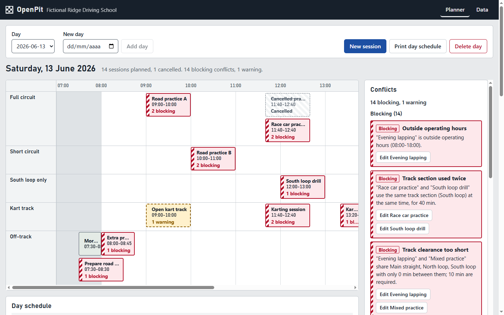
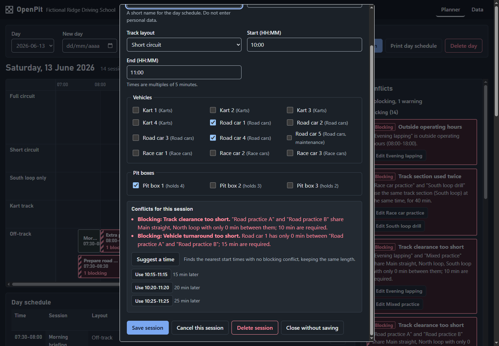

# OpenPit

A configurable, local-first web app that helps racing schools plan a day of track operations and catch scheduling conflicts before they reach the pit lane.



**Status:** the MVP is implemented. It runs in the browser, stores data on the device and has no server. It is not yet installable or usable offline from a cold start; that is roadmap phase R1. See [ROADMAP.md](ROADMAP.md).

## What it does

An operations coordinator builds one day's track schedule, assigns vehicles and pit boxes, and sees every conflict (overlaps, capacity, availability, turnaround) immediately. A deterministic rule engine explains each conflict and can propose the nearest conflict-free start time for a session. No account, no server and no personal data.



## Implemented in the MVP

- Day planner with one lane per track layout, an off-track lane, closures drawn on the lanes, and an accessible schedule table.
- Create, edit, cancel, restore and delete sessions in a keyboard-operable dialog. Assign vehicles and pit boxes.
- 13 conflict rules (12 blocking, 1 warning), shown in a conflicts panel and in the session dialog before saving. Conflicts are never signalled by colour alone.
- "Suggest a time": up to three nearest start times with no blocking conflict, or a statement that none exists.
- Day adjustments: close a track section for a time window, mark a vehicle unavailable, cancel a session.
- Autosave to a local database (PGlite on IndexedDB) with recovery after reload.
- JSON import (validated completely before anything is saved) and export; print stylesheet for the day schedule.
- Command line: validate a workspace file and generate synthetic sample data.

Not in the MVP: multiple circuits, an in-app configuration editor (the school configuration is a validated JSON file), drag and drop, undo, templates, PDF or CSV export, schedule versions, installable app or offline launch, sync and accounts. These are planned in the [roadmap](ROADMAP.md).

## Quick start

Requires Node.js 26.13.0 or newer and pnpm 12.16.1.

```
pnpm install --frozen-lockfile
pnpm dev
```

Open the printed address. On a fresh browser profile choose "Load the fictional sample school". It contains one day with deliberate conflicts.

Check the same file from the command line:

```
pnpm validate data/samples/fictional-ridge.json
```

This prints 14 blocking conflicts and 1 warning and exits with code 1. See [docs/development.md](docs/development.md) for all commands, exit codes and the manual walkthrough.

## Technology

| Area            | Choice                              | Version            |
| --------------- | ----------------------------------- | ------------------ |
| Runtime         | Node.js                             | >=26.13.0          |
| Package manager | pnpm                                | 12.16.1            |
| Framework       | Next.js (App Router, static export) | 16.4.4             |
| UI              | React, React DOM                    | 19.3.1             |
| Language        | TypeScript                          | 7.0.2              |
| Local database  | PGlite (`@electric-sql/pglite`)     | 0.5.14             |
| Validation      | Zod                                 | 4.6.7              |
| Tests           | Vitest                              | 5.1.0              |
| Lint and format | Biome                               | 2.6.4              |
| Styling         | CSS Modules and custom properties   | built into Next.js |

Versions are read from `package.json` and pinned exactly. Dependencies must be at least seven days old.

## How it is built

`src/domain` (types, schemas, time math) and `src/engine` (pure conflict rules) are plain TypeScript with no framework imports; the engine imports only from the domain. `src/storage` keeps data in PGlite behind a repository. `src/features` and `src/app` are the React screens. See [docs/architecture.md](docs/architecture.md).

## Things to know

- **Rule defaults are assumptions.** The author has no contact at a racing school. Clearance, turnaround, capacity and operating-hours rules are product assumptions, not industry facts. They are labelled in [docs/domain.md](docs/domain.md) and are configurable per school.
- **Browsers can delete site data.** OpenPit asks for persistent storage and the Data page exports a full JSON backup, but a backup is the only real safeguard.
- **One tab at a time.** A second tab shows a notice instead of editing.
- **Tested in Chromium only.** Firefox and Safari were not tried. Accessibility was checked with an automated audit and by hand for the keyboard path, not with a full WCAG audit.
- **First open is slow.** The database is a multi-megabyte WebAssembly download; the first open took about two seconds on the development machine.
- **The CI workflow has not run yet.** The repository has local commits only, so `.github/workflows/ci.yml` has not executed on GitHub. Its steps were run locally.

## Documentation

- [docs/domain.md](docs/domain.md): entities, invariants and conflict rules
- [docs/api.md](docs/api.md): engine contract
- [docs/architecture.md](docs/architecture.md): layers, data flow, storage
- [docs/security.md](docs/security.md): privacy, trust boundaries, known gaps
- [docs/development.md](docs/development.md): commands, CLI, tests, manual walkthrough
- [docs/landscape.md](docs/landscape.md): survey of existing tools
- [docs/adr](docs/adr): architecture decision records
- [AGENTS.md](AGENTS.md): conventions for contributors

## Ownership

This is a 100% independent, personal side project. It is not related to, sponsored by, or developed for any employer or client.

## License

Copyright (c) 2026 David Espinosa. MIT license, see LICENSE.
