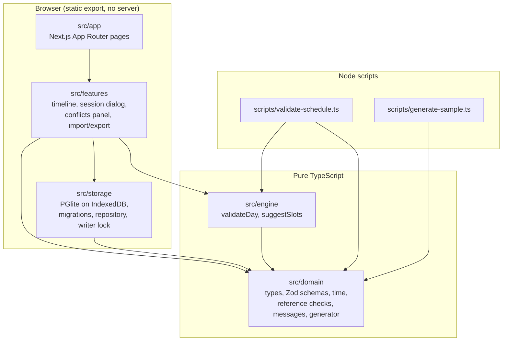
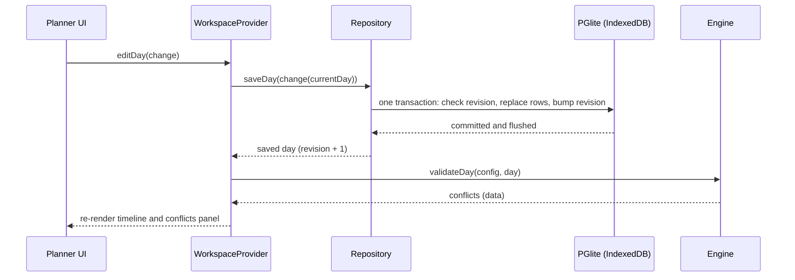

# Architecture

OpenPit is a static web app. Everything runs in the browser; the CLI scripts run in Node and share the same domain and engine code.

## Layers

| Layer          | May import                 | Notes                                                                                                                           |
| -------------- | -------------------------- | ------------------------------------------------------------------------------------------------------------------------------- |
| `src/domain`   | itself, `zod`              | Types come from the Zod schemas. Includes time math, reference checks, the conflict message formatter and the seeded generator. |
| `src/engine`   | `src/domain` only          | Enforced by a Biome `noRestrictedImports` override and by `tests/engine-isolation.test.ts`. No clock, randomness or locale.     |
| `src/storage`  | `src/domain`, PGlite       | The repository talks to a minimal SQL interface (`SqlDatabase`), so tests run it on in-memory PGlite in Node.                   |
| `src/features` | domain, engine, storage    | React components and pure view models (`edit.ts`, `timeline.ts`) that are tested without React.                                 |
| `src/app`      | features                   | Routes `/` (planner) and `/data`.                                                                                               |
| `scripts`      | `src/domain`, `src/engine` | Run with Node's native TypeScript support.                                                                                      |

## Data flow in the browser

- Writes are queued so each starts from the day the previous one saved.
- The screen is updated only after the save succeeded. A failed save reloads the stored day and shows the error.
- Conflicts are recomputed from the saved day on every change; they are never stored.

## Storage

Schedule data is relational: `schedule_day`, `session`, `session_vehicle`, `session_pit_box`, `track_closure`, `vehicle_unavailability`, with foreign keys and CHECK constraints for valid time blocks. The school configuration is one validated JSONB document in `workspace_config`. Migrations are numbered SQL files in `src/storage/migrations`, bundled into `migrations.generated.ts` by `pnpm build:migrations`, applied by a small runner that records versions in `schema_version`. See ADR [0003](adr/0003-pglite-persistence.md) and [0004](adr/0004-persistence-spike-result.md).

Every committed transaction is followed by an explicit flush to IndexedDB (`withDurableTransactions`), because the spike showed the last save was otherwise lost on reload.

## Single writer

On start the provider takes the Web Lock `openpit-writer`. A second tab fails to get it (after a short retry that covers a page that is still closing) and shows a notice instead of opening the database.

## Time and determinism

Times are integer minutes since midnight in half-open intervals (ADR [0002](adr/0002-minutes-since-midnight-time-model.md)). The engine sorts its inputs by ID and its output by a total order, so shuffling inputs never changes results.

## Decisions

Recorded in [docs/adr](adr): static export without a backend, the time model, and the persistence choice with its spike result.
